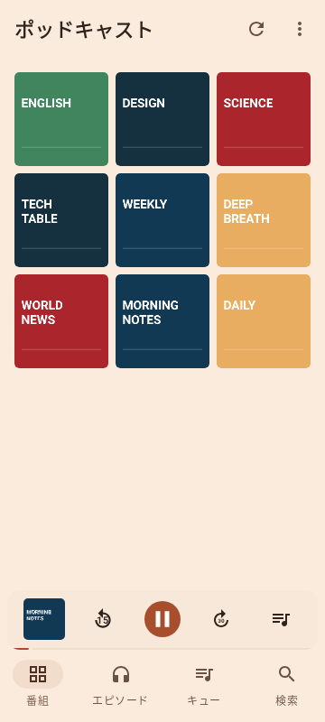
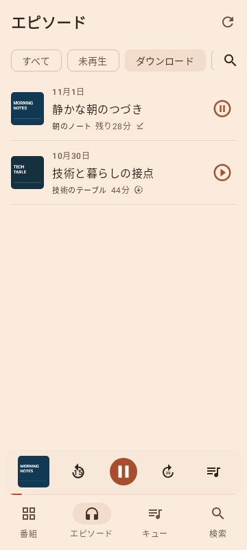
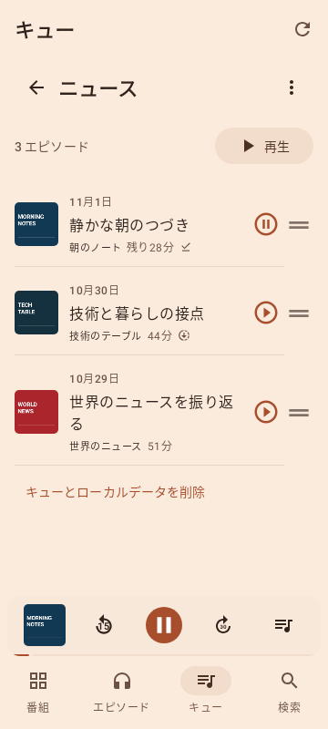
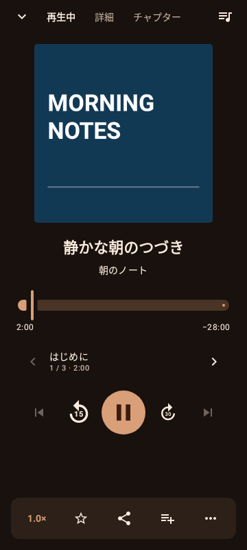

# GalenaCast

好きな番組を、自分のペースで聴くためのAndroidアプリです。
アカウント登録は不要。購読・再生履歴・ダウンロードした音声を端末内で管理します。

**[APKをダウンロード](https://github.com/sasakiy84/podcast-android/releases/latest)** · Android 16 以降に対応

リリースページの「Assets」から `.apk` を選んでインストールできます。

## できること

- **番組を探して登録** — Apple Podcastsで検索。RSS / Atomや、主要サービスの番組URLからも登録できます。番組ごとの新着通知にも対応しています。
- **聴く順番をキューで整理** — ニュース・技術・英語学習など、複数のキューを作れます。新着をキーワード・除外語で自動追加でき、聴き終わった回はすべてのキューから外れます。
- **保存してオフライン再生** — 自動ダウンロードとWi-Fi限定保存に対応。再生完了時には保存音声を自動削除し、キュー内の音声をまとめて整理することもできます。
- **自分に合う再生設定** — 再生速度は全体・番組別に設定。番組ごとの冒頭・末尾スキップ、15秒戻し・30秒送り、チャプター移動が使えます。
- **音量をそろえて聴く** — 番組ごとの音量差を自動補正。保存音声は事前に解析し、ストリーミングにも対応します。「標準」「大きめ」から選べます。
- **あとから探し直す** — タイトル・説明の検索、お気に入り、再生履歴から聴きたい回へ。エピソード一覧は「ダウンロード」から開き、スワイプや長押しで操作できます。
- **共有と乗り換え** — タイトルやリンクをコピー・共有でき、再生位置を含めることもできます。他のアプリとの購読リストの移行にはOPMLの取り込み・書き出しが使えます。

## スクリーンショット

| 番組一覧 | ダウンロード |
| :---: | :---: |
|  |  |

| キュー | 再生画面 |
| :---: | :---: |
|  |  |

画面はサンプルの番組・エピソードを使っています。

## 名前について

Galena（方鉛鉱）は鉱石ラジオの検波器に使われた鉱石、Castはポッドキャストに由来します。
ロゴは結晶とイヤホン、銅色の配色は鉱石ラジオの銅線をモチーフにしています。

購読や履歴のクラウド同期はありません。公開RSSのない限定・独占配信には対応していません。
