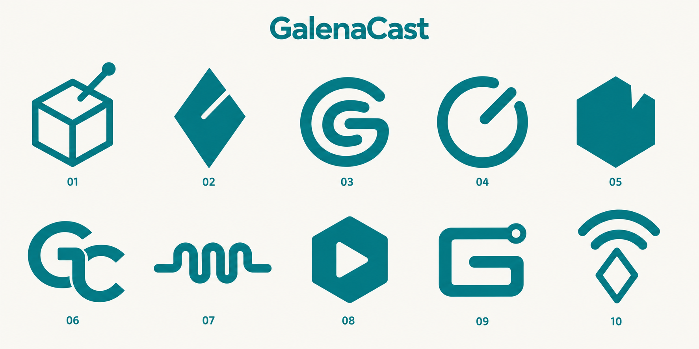

# GalenaCast のロゴ案

Galena は方鉛鉱。鉱石ラジオの結晶・検波針・コイルを、少ない図形と太い線で表す10案です。背景色とアクセント色の2色だけを使い、立体表現や質感を省きます。

- 背景: オフホワイト `#FAF8F3`
- アクセント: 青緑 `#007F86`

| 案 | モチーフ | 特徴 |
| --- | --- | --- |
| 01 | 結晶と検波針 | 立方体の輪郭と一本の針で、名前の由来を直接表現 |
| 02 | 結晶の切り込み | ひし形と接点の切り込みを組み合わせた記号 |
| 03 | コイルのG | 一筆のコイルを頭文字Gに見立てた丸い形 |
| 04 | 同調ダイヤル | 円と一本の針だけで周波数調整を表現 |
| 05 | 切り欠いた鉱石 | 六角形の鉱石に検波針の接点を示す切り欠き |
| 06 | GC | 二つの頭文字を重ねたモノグラム |
| 07 | コイル | 一続きの線で三巻きのコイルを表現 |
| 08 | 結晶と再生記号 | 六角形に再生マークを抜いた、音声アプリと分かりやすい形 |
| 09 | 回路のG | 頭文字を回路の線と端子に見立てた角形の記号 |
| 10 | 結晶と電波 | 小さな結晶と二つの電波の弧 |

採用案を決めてから、Androidのアダプティブアイコンとモノクロアイコンに仕上げます。
