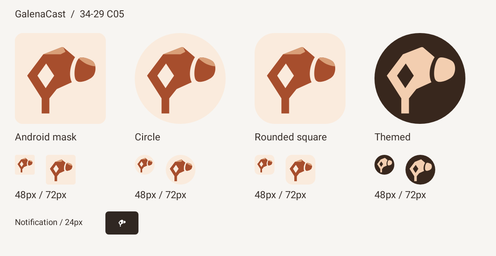
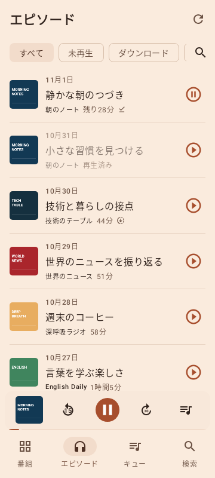
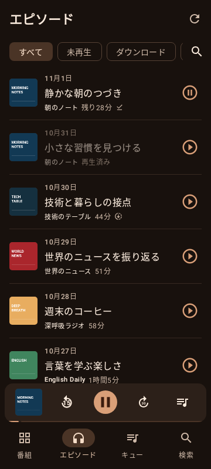

# GalenaCast のロゴと配色

採用案は **34-29 / C05**。方鉛鉱を思わせる角張った結晶とイヤホンを一つの形にし、中央にひし形の抜きを入れています。本体上部とイヤーピースの淡い面で、鉱石のファセットを表現します。


| 用途 | 色 |
| --- | --- |
| 背景のクリーム | `#FAEBDD` |
| 本体の赤茶・銅色 | `#A74E2D` |
| 淡い銅色の面 | `#D99F78` |

鉱石ラジオで使われる銅線を連想する配色です。背景・本体・淡色の面の3色を使い、グラデーションや質感は加えません。

`logo.svg` が形と色の編集元です。変更後は次のコマンドでAndroidのベクターリソースへ反映します。

```sh
python3 scripts/generate-brand-assets.py
```

ランチャーにはアダプティブアイコンを使い、丸型・角丸型に対応します。テーマアイコンと通知には、ひし形の抜きとイヤーピースの隙間を保った単色のシルエットを使います。

## Androidでの表示



Android 16の実リソースをRobolectricのネイティブ描画で撮影。48px・72pxと通知の24pxも確認しています。再撮影の手順は [開発・テスト](../testing.md#画面撮影) を参照してください。

## アプリ内の配色

画面もC05の銅色とクリームを使います。ライト表示はアイコンと同じ背景色・アクセント、ダーク表示と再生画面は黒茶色と淡い銅色です。ボタン・タブ・リンク・設定・起動時の背景まで共通テーマに揃えています。

| 用途 | ライト | ダーク |
| --- | --- | --- |
| 背景 | `#FAEBDD` | `#18110D` |
| アクセント | `#A74E2D` | `#D99F78` |
| 本文 | `#30231D` | `#FAEBDD` |

| ライト | ダーク |
| --- | --- |
|  |  |

基本の文字色と背景色は、ライト／ダーク各27組で4.5:1以上を確認しています。
